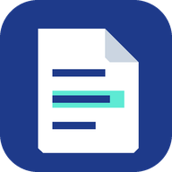

<p align="center">
  
</p>

<h1 align="center">EduNote</h1>

<p align="center">
  Study notes for a tablet with a stylus and for the computer: handwriting on A4 pages, live Markdown,
  a PDF reader beside the note, flashcards and an AI assistant.
</p>

<p align="center">
  <a href="https://github.com/D3anDark/edunote-releases/releases/latest"></a>
  <a href="https://github.com/D3anDark/edunote-releases/releases"></a>
</p>

<p align="center"><b>English</b> · <a href="README.pl.md">Polski</a></p>

## Download

| System | File | |
|---|---|---|
| Android (most phones and tablets) | `app-arm64-v8a-release.apk` | [Download](https://github.com/D3anDark/edunote-releases/releases/latest/download/app-arm64-v8a-release.apk) |
| Android (older 32-bit devices) | `app-armeabi-v7a-release.apk` | [Download](https://github.com/D3anDark/edunote-releases/releases/latest/download/app-armeabi-v7a-release.apk) |
| Android (x86_64, emulator) | `app-x86_64-release.apk` | [Download](https://github.com/D3anDark/edunote-releases/releases/latest/download/app-x86_64-release.apk) |
| Linux (x86_64) | `EduNote-x86_64.AppImage` | [Download](https://github.com/D3anDark/edunote-releases/releases/latest/download/EduNote-x86_64.AppImage) |
| Windows (x64) | `EduNote-windows-x64.zip` | [Download](https://github.com/D3anDark/edunote-releases/releases/latest/download/EduNote-windows-x64.zip) |
| macOS | `EduNote-macos.zip` | [Download](https://github.com/D3anDark/edunote-releases/releases/latest/download/EduNote-macos.zip) |

Every version, with what changed, is on the [releases page](https://github.com/D3anDark/edunote-releases/releases).

## Install

**Android.** Open the APK and allow your browser or file manager to install apps when Android asks.

**Linux.** Make the file executable and run it:

```sh
chmod +x EduNote-x86_64.AppImage
./EduNote-x86_64.AppImage
```

If it does not start, run it with `--appimage-extract-and-run`.

**Windows.** Unzip the folder anywhere and run `edunote.exe`. The app is not signed, so SmartScreen may warn:
choose *More info*, then *Run anyway*.

**macOS.** Unzip and move `edunote.app` to *Applications*. The app is not signed: if macOS blocks it, open
*System Settings*, *Privacy & Security*, and choose *Open Anyway*.

Windows and macOS builds are compiled on every release but not yet tested on real machines.

## Updates

The app checks this page when it starts and offers a new version when there is one; *Settings* (*Ustawienia*),
*Updates* (*Aktualizacje*) checks on demand. On Android it downloads the APK and opens the system installer; the
AppImage replaces itself and starts as the new version next time. On Windows (from version 1.2.0) it downloads the zip
and swaps the app folder once you close EduNote; the folder must be one you can write to, so not *Program Files*.
macOS links here. Your notes stay in every case.

## What it does

- **Mixed notes**: pages with typed text and handwriting together, A4 or A3, A5, B5, Letter and Legal, upright or
  landscape. Pen, highlighter, eraser and lasso; plain, lined, squared or dotted paper with rules 5 to 10 mm apart.
  Share a note as PDF or as a `.mdink` file that keeps its pages and ink. A held stroke straightens into a line,
  ellipse or rectangle. Import a PDF as page background, export to PDF with real text and the ink on top.
- **Text notes**: Markdown shown as you type, like Obsidian. LaTeX formulas, tables edited in
  place, images, checklists, a slide-by-slide presentation mode and a reading view (Ctrl+E) that shows the note as a
  finished page. [Preview a Markdown file](https://deandark.me/EduNote/en#preview) on the website to see how EduNote
  shows it. Shortcuts work as in other editors: Tab and Shift+Tab move a list item a level, Ctrl+H finds and
  replaces, Alt+Up/Down move lines.
- **Open with EduNote**: a `.md` file from the file manager opens as a note, and opening it again brings back the same
  note. The file on disk stays as it was.
- **PDF reader beside the note**: search, highlights in six colors, quotes with a link to the page, the book's own page
  numbers. Scans are recognized by the built-in OCR (PaddleOCR), with nothing to install.
- **Order**: folders, pins, `#tags`, `[[links]]` between notes, full-text search, a trash kept for 30 days and templates
  (lecture, Cornell method, lab report, lesson plan, test and more).
- **Review**: tasks with due dates collected from all notes, flashcards from `question :: answer` lines and
  `{{cloze}}` gaps with spaced repetition, every highlight in one list.
- **AI assistant**: a button on the note toolbar summarizes the note, makes flashcards from it, explains it more simply
  and quizzes you like a tutor; each note keeps its chats. Gemini, Claude or any OpenAI-compatible server, including
  local ones like Ollama and LM Studio, with your own key. Nothing is sent until you set it up.

## Your data

Notes stay on your device in a local database; the app keeps no account and no cloud copy. It goes online only to the
AI provider you set up, to this page to check for updates, and to the report server when you send a report. A backup zip, a daily backup inside the app and export to
Markdown files are in *Settings*.

The app is in English and Polish: it follows your system language and falls back to English.

## Feedback

Found a bug or missing something? Preferably [open an issue on GitHub](https://github.com/D3anDark/edunote-releases/issues/new/choose):
you can follow the answer and progress there. Without an account, send it from the app (*Settings*, *Report a bug or
an idea*) or from the [help page](https://deandark.me/EduNote/en/docs/help#report).
