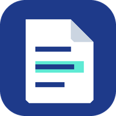

<p align="center">
  
</p>

<h1 align="center">EduNote</h1>

<p align="center">
  Notatki do nauki na tablet z rysikiem i na komputer: pismo odręczne na stronach A4, Markdown na żywo,
  czytnik PDF obok notatki, fiszki i asystent AI.
</p>

<p align="center">
  <a href="https://github.com/D3anDark/edunote-releases/releases/latest"></a>
  <a href="https://github.com/D3anDark/edunote-releases/releases"></a>
</p>

<p align="center"><a href="README.md">English</a> · <b>Polski</b></p>

## Pobierz

| System | Plik | |
|---|---|---|
| Android (większość telefonów i tabletów) | `app-arm64-v8a-release.apk` | [Pobierz](https://github.com/D3anDark/edunote-releases/releases/latest/download/app-arm64-v8a-release.apk) |
| Android (starsze urządzenia 32-bitowe) | `app-armeabi-v7a-release.apk` | [Pobierz](https://github.com/D3anDark/edunote-releases/releases/latest/download/app-armeabi-v7a-release.apk) |
| Android (x86_64, emulator) | `app-x86_64-release.apk` | [Pobierz](https://github.com/D3anDark/edunote-releases/releases/latest/download/app-x86_64-release.apk) |
| Linux (x86_64) | `EduNote-x86_64.AppImage` | [Pobierz](https://github.com/D3anDark/edunote-releases/releases/latest/download/EduNote-x86_64.AppImage) |
| Windows (x64) | `EduNote-windows-x64.zip` | [Pobierz](https://github.com/D3anDark/edunote-releases/releases/latest/download/EduNote-windows-x64.zip) |
| macOS | `EduNote-macos.zip` | [Pobierz](https://github.com/D3anDark/edunote-releases/releases/latest/download/EduNote-macos.zip) |

Wszystkie wersje, z opisem zmian, są na [stronie wydań](https://github.com/D3anDark/edunote-releases/releases).

## Instalacja

**Android.** Otwórz plik APK i pozwól przeglądarce albo menedżerowi plików instalować aplikacje, gdy Android o to
zapyta.

**Linux.** Nadaj plikowi prawo uruchamiania i uruchom go:

```sh
chmod +x EduNote-x86_64.AppImage
./EduNote-x86_64.AppImage
```

Jeśli się nie uruchamia, dodaj `--appimage-extract-and-run`.

**Windows.** Rozpakuj folder w dowolnym miejscu i uruchom `edunote.exe`. Aplikacja nie jest podpisana, więc SmartScreen
może ostrzec: wybierz *Więcej informacji*, potem *Uruchom mimo to*.

**macOS.** Rozpakuj i przenieś `edunote.app` do *Aplikacji*. Aplikacja nie jest podpisana: jeśli macOS ją zablokuje,
otwórz *Ustawienia systemowe*, *Prywatność i ochrona*, i wybierz *Otwórz mimo to*.

Wersje na Windows i macOS są budowane przy każdym wydaniu, ale nie były jeszcze sprawdzone na prawdziwym komputerze.

## Aktualizacje

Aplikacja przy starcie sprawdza tę stronę i proponuje nową wersję, gdy taka jest; *Ustawienia*, *Aktualizacje*
sprawdzają na żądanie. Na Androidzie pobiera APK i otwiera systemowy instalator, AppImage podmienia sam siebie i przy
następnym starcie uruchamia się nowa wersja. Windows i macOS dostają link tutaj. Notatki zostają w każdym przypadku.

## Co potrafi

- **Notatki mieszane**: strony A4 z tekstem i pismem odręcznym razem. Pióro, zakreślacz, gumka i lasso; kartka czysta,
  w linie, w kratkę lub w kropki. Przytrzymana kreska prostuje się w odcinek, elipsę albo prostokąt. Import PDF jako
  podkład stron, eksport do PDF z prawdziwym tekstem i tuszem na wierzchu.
- **Notatki tekstowe**: Markdown widoczny od razu, jak w Obsidianie. Wzory LaTeX, schematy blokowe Mermaid, tabele
  edytowane w miejscu, obrazy, listy zadań i prezentacja slajd po slajdzie.
- **Czytnik PDF obok notatki**: szukanie, zakreślenia w sześciu kolorach, cytaty z odsyłaczem do strony, numeracja
  z książki. Skany rozpoznaje OCR na komputerze (potrzebny [Tesseract](https://tesseract-ocr.github.io/)).
- **Porządek**: foldery, przypinanie, `#tagi`, `[[linki]]` między notatkami, wyszukiwanie pełnotekstowe, kosz na 30 dni
  i szablony (wykład, metoda Cornella, sprawozdanie, konspekt lekcji, sprawdzian i inne).
- **Powtórki**: zadania z terminami zebrane ze wszystkich notatek, fiszki z linii `pytanie :: odpowiedź` i luk
  `{{tak}}` z powtórkami w odstępach, wszystkie zakreślenia na jednej liście.
- **Asystent AI**: Gemini, Claude albo dowolny serwer zgodny z OpenAI, także lokalny, jak Ollama i LM Studio, z Twoim
  kluczem.

## Twoje dane

Notatki zostają na urządzeniu, w lokalnej bazie; aplikacja nie ma konta ani kopii w chmurze. Łączy się tylko z
dostawcą AI, którego ustawisz, i z tą stroną, żeby sprawdzić aktualizacje. Kopia zapasowa w pliku zip, codzienna kopia
w aplikacji i eksport do plików Markdown są w *Ustawieniach*.

Interfejs jest na razie po polsku.

## Uwagi

Znalazłeś błąd albo czegoś brakuje? [Zgłoś to tutaj](https://github.com/D3anDark/edunote-releases/issues).
